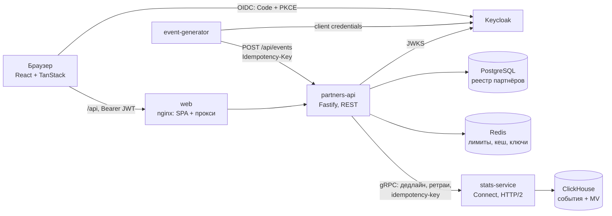

# partner-analytics-demo

[](https://github.com/VladisLoveXo/partner-analytics-demo/actions/workflows/ci.yml)

Учебный pet-проект: кабинет партнёра и админка с аналитикой переходов и конверсий.
Сделан, чтобы руками разобраться в связке, которой не было в моих рабочих проектах:
**gRPC / Protobuf, ClickHouse, Kubernetes + Helm, OIDC (Keycloak), TanStack Router / Query, Redis, Testcontainers**.
Это не коммерческий проект: нагрузку даёт генератор трафика, а не реальные партнёры.

| Слой | Технологии |
|---|---|
| Сервисы | Node.js 24, TypeScript 7, Fastify 5 (REST), Connect-ES 2 (gRPC поверх HTTP/2), zod |
| Контракт | Protobuf, buf (lint, генерация, проверка в CI) |
| Данные | ClickHouse 26.8 (события и агрегаты), PostgreSQL 18 (реестр партнёров), Redis 7 (лимиты, кеш, ключи идемпотентности) |
| Вход | Keycloak 26: Authorization Code + PKCE для SPA, client credentials для сервиса, роли partner / admin / ingest |
| Фронт | React 19, TanStack Router (файловые маршруты, типизированные search params), TanStack Query, Tailwind 4, Recharts |
| Тесты | Vitest, Testcontainers (ClickHouse, PostgreSQL, Redis), 88 тестов |
| Запуск | docker compose; Helm 4 + kind; GitHub Actions ставит чарт в kind на каждый push |

## Архитектура



- **partners-api** - REST для фронта и приёма событий. Проверяет токен, решает, кому какие данные можно, ограничивает частоту запросов, кеширует агрегаты, ходит в stats-service по gRPC.
- **stats-service** - gRPC-сервис над ClickHouse: пишет события, отдаёт агрегаты по дням и итоги по партнёрам. Наружу не торчит.
- **web** - nginx отдаёт SPA и проксирует `/api` в partners-api: браузер видит один origin, CORS не нужен.
- **event-generator** - имитирует трекер: получает сервисный токен и шлёт историю за 30 дней, затем живой трафик. Часть батчей специально отправляет повторно.

## Быстрый старт

Нужен только Docker.

```bash
docker compose up -d --build
```

Через минуту-две откройте http://localhost:3000. Генератор за это время зальёт 30 дней истории (около 125 тысяч событий) и продолжит слать живой трафик.

| Пользователь | Пароль | Что видит |
|---|---|---|
| `alpha` | `alpha` | кабинет партнёра «Альфа Медиа», только свои данные |
| `beta` | `beta` | кабинет партнёра «Бета Трафик» |
| `admin` | `admin` | админку: всех партнёров, переход в любого, создание и отключение |

Keycloak: http://localhost:8080 (консоль `admin` / `admin`). Пароли демонстрационные и лежат в `infra/keycloak/realm-partners.json`.

Полезное для разбора:

```bash
# gRPC напрямую, мимо REST
npx buf curl --protocol grpc --http2-prior-knowledge --schema proto \
  -d '{"partner_id":"alpha","from":"2026-10-24","to":"2026-10-30"}' \
  http://localhost:50051/stats.v1.StatsService/GetPartnerDaily

# Сверка агрегатов с сырыми событиями (пустой результат = расхождений нет)
docker compose exec -T clickhouse clickhouse-client --user app --password app < scripts/reconcile.sql

# Повторный прогон истории: цифры за прошлые дни не меняются
docker compose run --rm -e LIVE=false event-generator

# Сбои stats-service: половина вызовов получает UNAVAILABLE, в логах partners-api видны ретраи
CHAOS_UNAVAILABLE_RATE=0.5 docker compose up -d stats-service
docker compose logs -f partners-api | grep retrying
```

Разработка без контейнеров для сервисов: `npm install`, затем `npm run dev -w services/stats-service`, `npm run dev -w services/partners-api`, `npm run dev -w apps/web` (Vite на :5173 проксирует `/api`). Инфраструктуру проще оставить в compose.

## Как это устроено

### gRPC: контракт, дедлайны, повторы, идемпотентность

Контракт в [`proto/stats/v1/stats.proto`](proto/stats/v1/stats.proto), три метода: `IngestEvents`, `GetPartnerDaily`, `ListPartnerTotals`.
buf проверяет стиль (`buf lint`), генерирует TypeScript (`protoc-gen-es`) в каждый сервис, CI падает, если сгенерированный код разошёлся с proto.

- **Дедлайн на весь вызов.** partners-api ставит `timeoutMs` (чтение 1,5 с, запись 3 с), он уходит заголовком `grpc-timeout`. В stats-service `ctx.signal` передаётся в запрос к ClickHouse, а для чтения включён `cancel_http_readonly_queries_on_client_close`: истёкший дедлайн отменяет запрос в базе, а не только на клиенте.
- **Повторы по контракту.** Интерцептор [`retry.ts`](services/partners-api/src/stats/retry.ts) повторяет только `UNAVAILABLE` и только методы, которые в proto помечены `idempotency_level` (`NO_SIDE_EFFECTS` для чтения, `IDEMPOTENT` для записи). Экспоненциальная пауза с full jitter, все попытки укладываются в тот же дедлайн. `DEADLINE_EXCEEDED` не повторяется: время уже вышло.
- **Ключ идемпотентности в метаданных.** Ключ фиксируется до цикла повторов и уходит заголовком `idempotency-key` в каждой попытке. Без ключа stats-service отвечает `INVALID_ARGUMENT`.
- **Health и пробы.** stats-service реализует стандартный `grpc.health.v1.Health`. Kubernetes проверяет его нативными gRPC-пробами, docker compose - тем же вызовом. При остановке сервис сначала отвечает `NOT_SERVING`, потом шлёт клиентам GOAWAY и дожидается начатых вызовов.
- **Балансировка HTTP/2.** kube-proxy балансирует TCP-соединения, а gRPC-клиент держит одно соединение часами: вся нагрузка ушла бы в одну реплику. stats-service закрывает соединения старше 5 минут через GOAWAY, клиент переподключается, и новое соединение может попасть на другой под. Это покрыто тестом. Альтернативы: headless Service и балансировка на клиенте или service mesh.

### ClickHouse: дедупликация повторов

Схема в [`services/stats-service/migrations`](services/stats-service/migrations):

- `analytics.events` - сырые события, `ReplacingMergeTree`, ключ `(partner_id, event_date, event_id)`, партиции по месяцам.
- `analytics.partner_daily` - агрегаты по партнёру и дню (`SummingMergeTree`), их заполняет материализованное представление `partner_daily_mv`.

Повторы приходят двумя путями, и закрываются они по-разному:

1. **Повтор батча** (gRPC-ретрай, продюсер не получил ответ). Батч пишется одним `INSERT` с `insert_deduplication_token` = ключ идемпотентности, и ClickHouse пропускает повторную вставку целиком.
   Тонкость, которую поймал интеграционный тест: в ClickHouse 26.8 пропущенный в `events` блок всё равно проходит через MV. Агрегат остаётся точным, только когда выполнены оба условия:
   у целевой таблицы MV есть своё окно дедупликации и вставка идёт с `deduplicate_blocks_in_dependent_materialized_views = 1`.
   Проверено опытом: только настройка или только окно дают двойной счёт в MV при одной строке в сырой таблице.
2. **То же событие в другом батче.** Здесь работает `ReplacingMergeTree`: строки с одинаковым ключом схлопываются при слиянии кусков или при чтении с `FINAL`.
   Материализованное представление - триггер на вставку, слияний оно не видит и такое событие посчитает дважды. Это осознанный компромисс: дашборды читают быстрый агрегат, а точные цифры (сверка, выплаты) считаются по `events FINAL`, см. [`scripts/reconcile.sql`](scripts/reconcile.sql). Оба поведения зафиксированы в тесте.

Ещё детали:
- Окно дедупликации конечно (последние 10000 блоков): защита от ретраев, а не от повторной заливки месячной давности. Поэтому живой трафик идёт одним батчем на тик, а не батчем на партнёра.
- Дни без событий возвращаются нулями через `ORDER BY ... WITH FILL`, фронту не нужно дорисовывать пропуски.
- `SummingMergeTree` суммирует только при слияниях, поэтому чтение всегда идёт через `sum() ... GROUP BY`.
- Внутри одного батча дубли по `event_id` убираются до вставки.

### OIDC и изоляция данных

- **SPA** входит через Authorization Code + PKCE как публичный клиент `partners-web` (`oidc-client-ts`). Токены лежат в `sessionStorage`, обновляются refresh-токеном.
- **Генератор** - сервисный аккаунт: client credentials, роль `ingest`, отдельный клиент `event-generator`.
- **partners-api** проверяет подпись по JWKS, `iss`, `aud` (в токен добавлен audience `partners-api` mapper-ом) и фиксирует алгоритм RS256: токен для другого API или подделанный HS256 не пройдут.
- **Изоляция в одном месте**: [`canReadPartner`](services/partners-api/src/auth/principal.ts). `partner_id` берётся только из токена (атрибут пользователя в Keycloak, объявленный в user profile). Партнёр на чужой id получает 403 ещё до обращения к stats-service, admin видит всех. Проверки ролей во фронте только для удобства, решает сервер.
- Фронт не разбирает access token: роли и `partnerId` он узнаёт из `GET /api/me`.
- **Один issuer для браузера и подов.** Браузер ходит в Keycloak по `localhost`, а поды - по внутреннему адресу. `KC_HOSTNAME` фиксирует публичный URL как `iss`, `KC_HOSTNAME_BACKCHANNEL_DYNAMIC` пускает внутренние запросы, а partners-api берёт ключи по внутреннему `OIDC_JWKS_URL`.
- В проде я бы вынес токены из браузера в BFF (сессия на cookie, токены на сервере): XSS тогда не может их украсть. Здесь SPA с PKCE, чтобы показать сам протокол.

### Redis

- **Rate limit** - фиксированное окно на атомарном Lua-скрипте (`INCR` + `PEXPIRE` на первом запросе), счётчик на `sub` токена, ответ 429 с `Retry-After` и заголовками `RateLimit-*`. Известный минус окна - всплеск на стыке двух окон; лечится скользящим окном или token bucket.
- **Кеш агрегатов** - cache-aside с TTL 30 с для диапазонов, которые включают сегодня, и 10 минут для закрытых. Одинаковые промахи внутри процесса ждут одну загрузку (single-flight), заголовок `X-Cache` показывает HIT или MISS.
- **Ключ идемпотентности REST.** Атомарный `SET NX GET` запоминает отпечаток тела на 24 часа. Тот же ключ с другим телом даёт 409. Тот же ключ с тем же телом снова уходит в stats-service: первая попытка могла не дойти до ClickHouse, а дубль ClickHouse отбросит.
- **Fail open.** Redis недоступен - лимиты и кеш пропускаются с предупреждением в логе, запросы продолжают работать. По той же причине readiness проверяет только PostgreSQL: иначе сбой общей зависимости снял бы с балансировки все реплики сразу.

### Фронт

- Файловые маршруты TanStack Router: `/cabinet`, `/admin`, `/admin/partners/$partnerId`. Период и метрика лежат в типизированных search params (`?range=7d&metric=revenue`), ссылка воспроизводит то, что видит человек.
- Loader маршрута кладёт данные в кеш TanStack Query (`ensureQueryData`), компонент читает их через `useSuspenseQuery`. Диапазоны с сегодняшним днём обновляются раз в 30 секунд.
- Плитки KPI (клики, конверсии, CR, выручка, EPC) переключают график. На графике всегда одна метрика: две шкалы на одном графике рисуют корреляцию, которой нет.
- У графика есть табличный двойник. Тёмная тема следует настройке ОС. Цвета проверены валидатором на контраст и различимость при дальтонизме.

## Тесты

```bash
npm install
npm test        # нужен запущенный Docker: Testcontainers поднимет ClickHouse, PostgreSQL и Redis
```

| Пакет | Что проверяется |
|---|---|
| stats-service (15) | повтор батча не меняет ни сырые данные, ни MV; дубль в другом батче схлопывается в `FINAL`, а MV его считает; `WITH FILL`; изоляция партнёров; gRPC без ключа -> `INVALID_ARGUMENT`; health; переподключение клиента после GOAWAY |
| partners-api (58) | токены: чужой `iss` / `aud`, истёкший, HS256; изоляция: партнёр на чужого -> 403 без вызова stats-service; админка; приём событий: роль, ключ, 409, 422; rate limit -> 429; кеш, single-flight, fail open; ретраи с тем же ключом, дедлайн без лишних попыток, маппинг кодов gRPC в HTTP |
| web (8), генератор (7) | диапазоны дат в UTC, форматирование; детерминированность истории, валидные UUID v4 |

## Kubernetes: kind + Helm

```bash
bash scripts/kind-up.sh    # кластер kind, сборка образов, kind load, helm install infra и приложения
bash scripts/smoke.sh      # токен из Keycloak, REST через nginx, зависимости, данные в ClickHouse
```

UI: http://localhost:8081, Keycloak: http://localhost:8180 (порты пробрасывает [`deploy/kind/cluster.yaml`](deploy/kind/cluster.yaml)).

- [`deploy/charts/partner-analytics`](deploy/charts/partner-analytics) - приложение: Deployment и Service для трёх сервисов, Secret, миграции в init-контейнерах (PostgreSQL под advisory lock, ClickHouse идемпотентным DDL), нативные gRPC-пробы, `maxUnavailable: 0`, контрольная сумма секрета в аннотации для перезапуска подов, хук `post-install` с Job генератора.
- [`deploy/charts/infra`](deploy/charts/infra) - зависимости только для kind: PostgreSQL и ClickHouse в StatefulSet с томами, Redis, Keycloak с realm из ConfigMap. В проде это управляемые сервисы и корпоративный IdP.

### Логи: один запрос через три компонента

nginx присваивает запросу `X-Request-Id`, partners-api пишет его в свой лог и передаёт в gRPC-метаданных, stats-service логирует тот же id:

```text
$ kubectl -n partner-analytics logs -l app.kubernetes.io/name=partners-api -c partners-api | grep 9df5876be53d7991e5e0a2ac5634599a
{"level":30,"service":"partners-api","reqId":"9df5876be53d7991e5e0a2ac5634599a","req":{"method":"POST","url":"/api/events",...},"msg":"incoming request"}
{"level":30,"service":"partners-api","reqId":"9df5876be53d7991e5e0a2ac5634599a","res":{"statusCode":202},"responseTime":196.6,"msg":"request completed"}

$ kubectl -n partner-analytics logs -l app.kubernetes.io/name=stats-service -c stats-service | grep 9df5876be53d7991e5e0a2ac5634599a
{"level":30,"service":"stats-service","rpc":"IngestEvents","requestId":"9df5876be53d7991e5e0a2ac5634599a","ms":190,"msg":"rpc ok"}

$ kubectl -n partner-analytics logs job/event-generator --tail=1
{"service":"event-generator","message":"backfill finished","days":30,"events":125097,"accepted":125097,"resentBatches":36,"replays":36}
```

### Неудачный релиз и `helm rollback`

Выкатываем релиз с неверным паролем ClickHouse:

```text
$ helm -n partner-analytics upgrade partner-analytics deploy/charts/partner-analytics \
    --reuse-values --set clickhouse.password=wrong --wait --timeout 90s
Error: UPGRADE FAILED: resource Deployment/partner-analytics/stats-service not ready. status: InProgress, message: Updated: 1/2
context deadline exceeded

$ kubectl -n partner-analytics get pods -l app.kubernetes.io/name=stats-service
NAME                             READY   STATUS       RESTARTS      AGE
stats-service-5b5579f955-f6xwr   0/1     Init:Error   4 (55s ago)   90s
stats-service-668446c749-ccpqv   1/1     Running      0             2m37s
stats-service-668446c749-sgfhm   1/1     Running      0             2m37s
```

Новый под застрял на init-контейнере миграций, а два старых продолжают обслуживать запросы: `maxUnavailable: 0` не убирает старый под, пока новый не готов. Причина видна в логе init-контейнера:

```text
$ kubectl -n partner-analytics logs stats-service-5b5579f955-f6xwr -c migrate --tail=1
{"level":50,"service":"stats-service","err":{"type":"ClickHouseError","message":"app: Authentication failed: password is incorrect, or there is no user with such name.","code":"516"},"msg":"clickhouse migrations failed"}
```

Откатываемся на последнюю рабочую ревизию:

```text
$ helm -n partner-analytics history partner-analytics
REVISION  STATUS    DESCRIPTION
1         deployed  Install complete
2         failed    Upgrade "partner-analytics" failed: resource Deployment/partner-analytics/stats-service not ready...

$ helm -n partner-analytics rollback partner-analytics 1 --wait
Rollback was a success! Happy Helming!

$ helm -n partner-analytics history partner-analytics
REVISION  STATUS      DESCRIPTION
1         superseded  Install complete
2         failed      Upgrade "partner-analytics" failed: ...
3         deployed    Rollback to 1
```

В Helm 4 тот же откат делается автоматически флагом `--rollback-on-failure` (в Helm 3 он назывался `--atomic`).

## CI

[`.github/workflows/ci.yml`](.github/workflows/ci.yml):

1. **checks** - `buf lint`, сгенерированный код совпадает с proto, typecheck, все тесты с Testcontainers на Docker раннера, сборка.
2. **helm** - `helm lint` и `helm template` обоих чартов.
3. **kind** - кластер kind в раннере, сборка и загрузка образов, установка обоих чартов с `--wait` (Job генератора проходит всю цепочку Keycloak -> REST -> gRPC -> ClickHouse), затем `scripts/smoke.sh`.

## Что сознательно не сделано

- BFF вместо токенов в браузере (см. раздел про OIDC).
- OpenTelemetry: сквозной `x-request-id` уже идёт от nginx через partners-api в логи stats-service, следующий шаг - трейсы.
- Kafka перед ClickHouse, `ReplicatedMergeTree` и Keeper, HPA, Ingress, стриминговые RPC.

## Структура

```
proto/                      контракт stats.v1 и стандартный grpc.health.v1
services/stats-service/     gRPC-сервер над ClickHouse, миграции
services/partners-api/      REST, OIDC, Redis, gRPC-клиент, миграции PostgreSQL
apps/web/                   SPA и конфигурация nginx
tools/event-generator/      генератор трафика
infra/keycloak/             realm: клиенты, роли, демо-пользователи
deploy/                     Helm-чарты и конфиг kind
scripts/                    kind-up, smoke, сверка ClickHouse
```
